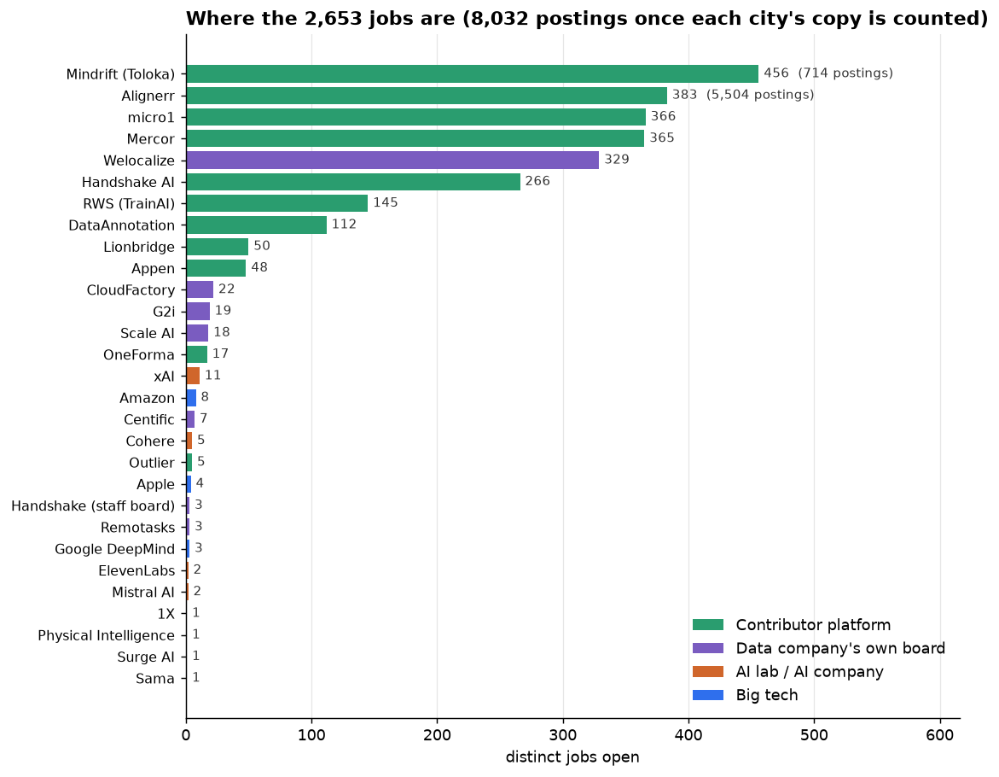
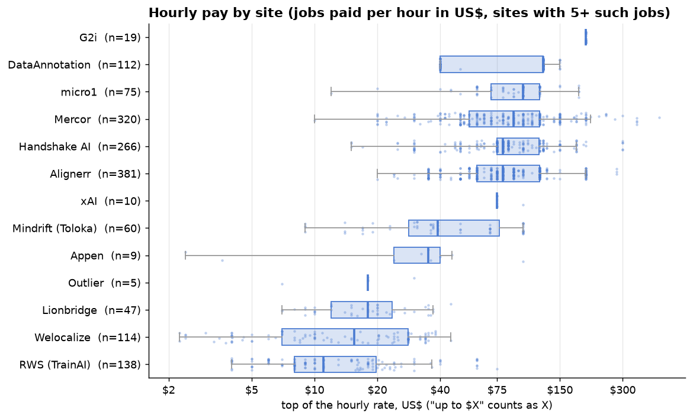
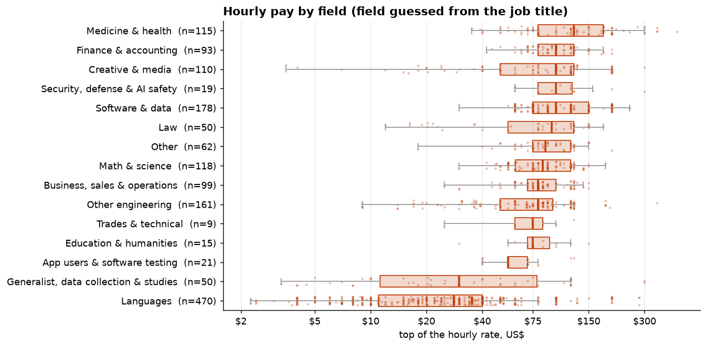
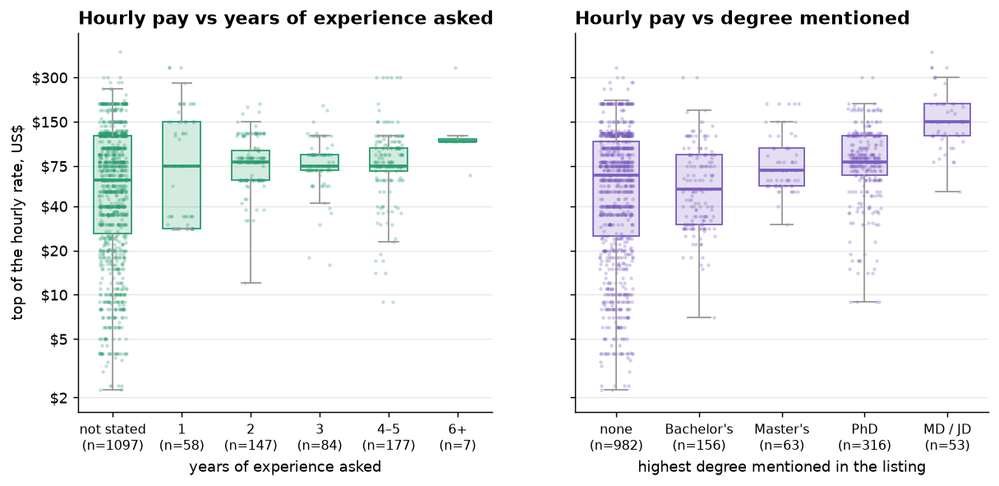
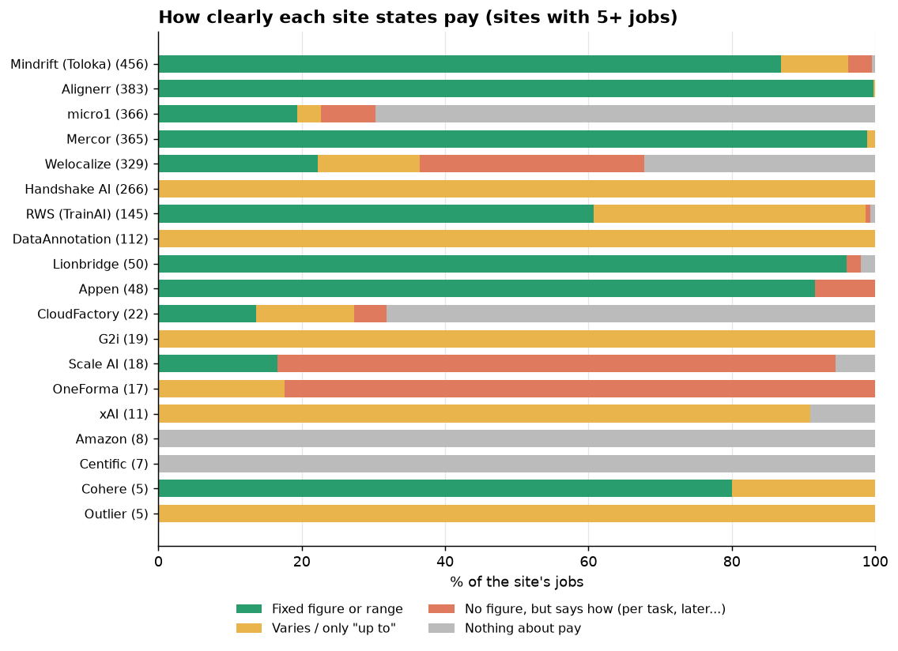
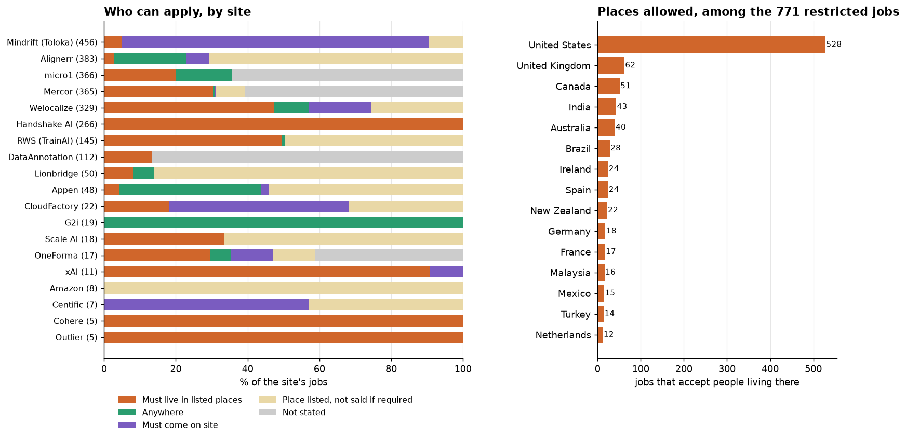
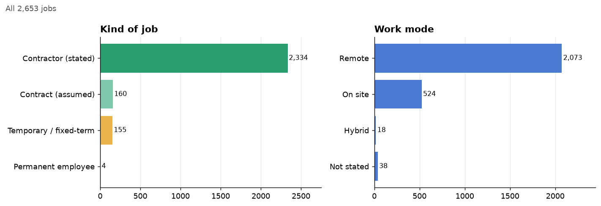

# What the listings look like

Snapshot of 2026-11-06: **2,653 distinct jobs** (8,032 postings; a job posted once per city or
country counts once), open listings only. Made with
`uv run --no-project --with matplotlib python -m annotationjobs.plots`.

How to read the pay charts: only jobs paid **per hour in US dollars** are compared (1,571 jobs),
using the **top** of each range, so "up to $125" counts as $125. Boxes show the middle half of
the jobs, the thick line is the median, each dot is one job. The pay axis is logarithmic: each
step doubles.

## 1. Where the jobs are

Contributor platforms hold 83% of the jobs (2,213). The AI labs post only 22 annotation-type
jobs between them, big tech 15. Alignerr looks huge by postings (5,504) but is 383 jobs posted
once per city.

## 2. Hourly pay by site

Two separate markets. Language and search-rating boards (RWS, Welocalize, Lionbridge) pay a
median of $11–18/hr, often for work done from lower-income countries. Expert platforms (Mercor,
Alignerr, Handshake, micro1, DataAnnotation) pay a median of $80–125/hr. DataAnnotation and
Handshake only give "up to" figures, so their real rates are likely lower than shown.

## 3. Hourly pay by field

Medicine pays the most (median $125/hr), then finance, software, law and creative work
(~$95–100). Language work is the lowest (median $28) and the widest spread. The field is
guessed from the job title by keywords, so expect some jobs in the wrong row.

## 4. Pay vs experience and degree

Degree matters more than years: MD/JD listings have a median of $150/hr, PhD $80, Master's
$70, Bachelor's $52. Asking for 1, 2, 3 or 4–5 years makes little difference (~$75–80). This
is a comparison, not cause and effect: the "none" group is mostly language work, which also
pays less.

## 5. How clearly pay is stated

56% of jobs give a fixed figure or range, 22% a variable or "up to" figure, 7% say how they pay
without a number ("per task", "shared later"), 15% say nothing. Mercor, Alignerr and Appen are
the clearest; micro1, Amazon and Centific say the least.

## 6. Who can apply

771 jobs require living in specific places, and 528 of those take people in the US. Handshake
is US-only. 495 jobs need you on site, mostly Mindrift's paid studies in New York. Many
listings name a place without saying whether it is required (pale yellow).

## 7. Kind of job and work mode

Nearly everything is freelance contract work (2,334 stated, 160 assumed). Only 4 jobs are
clearly permanent (two at Mistral, one at Physical Intelligence, one at Welocalize). 78% are
remote.
